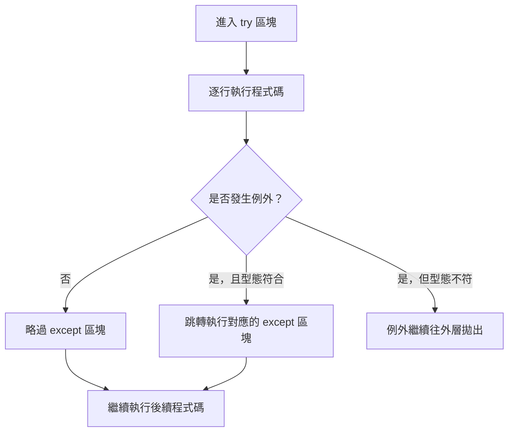
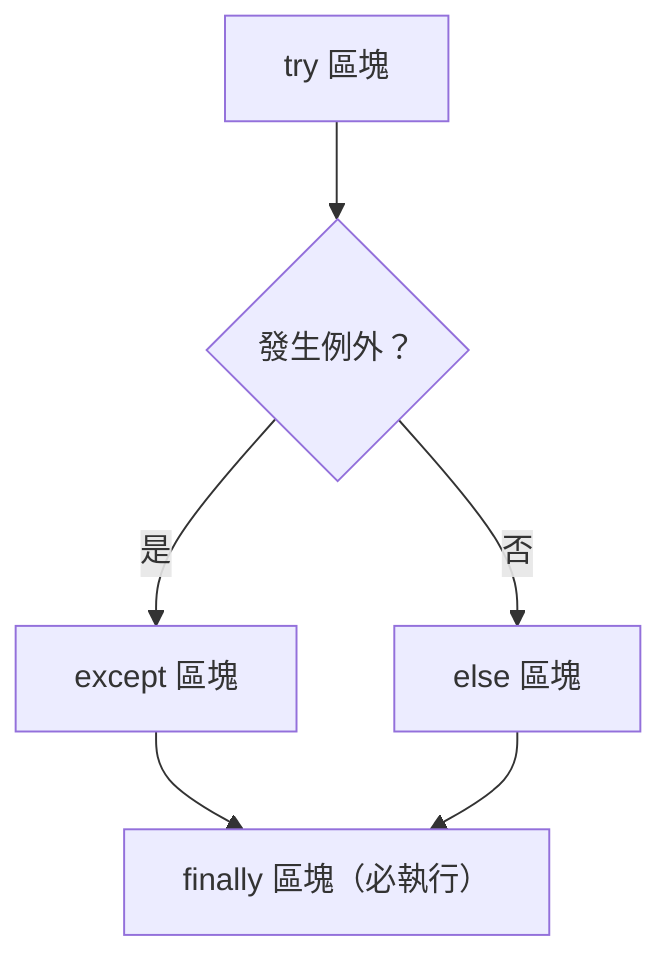

# Python 例外處理（`try ~ except`）由淺至深課程講義

> **課程目標**：從「為什麼程式會突然閃退」開始，循序漸進掌握 `try ~ except`、`else` / `finally`、例外繼承階層、`raise` 主動拋出、自訂例外與實務最佳實踐，讓程式在面對錯誤輸入或突發狀況時仍能穩定運作。

---

## 課程架構總覽


| 階段 | 主題 | 講解重點 |
| :--- | :--- | :--- |
| **入門** | 錯誤分類與 `try ~ except` | 區分 `SyntaxError` 與 `Exception`，學會讀 Traceback 並建立基本防護 |
| **基礎** | 精準捕捉與 `as e` | 捕捉指定例外、合併多種例外、依子父類別順序排列、取得錯誤細節 |
| **進階** | `else` 與 `finally` | 掌握四段式執行流程、資源清理保證、理解為何不把所有程式塞進 `try` |
| **實戰** | `raise` 與自訂例外 | 主動驗證資料、`from e` 例外鏈、繼承 `Exception` 建立領域例外 |
| **工程** | Best Practices 與測試 | EAFP vs LBYL、避免吞掉例外、使用 `unittest` 驗證例外行為 |

---

## 第一章（入門）：為什麼程式會當掉？認識錯誤與例外

### 1.1 語法錯誤（SyntaxError）vs. 執行階段例外（Exception）

在 Python 中，「出錯」主要分成兩種完全不同的情況：

1. **語法錯誤（`SyntaxError` / `IndentationError`）**：
   - 程式碼不符合 Python 語法規範（例如少打冒號 `:`、括號沒成對、縮排不一致）。
   - **無法用 `try ~ except` 捕捉**，因為直譯器在執行前解析程式碼時就會直接報錯停止。

   ```python
   # 語法錯誤範例：缺少冒號
   if True
       print("Hello")
   ```

2. **執行階段例外（Runtime Exception）**：
   - 語法完全合法，但程式「執行到一半」遇到無法處理的狀況（例如把 `"abc"` 轉成整數、除以 `0`、找不到檔案）。
   - **可以用 `try ~ except` 攔截並妥善處理**，避免程式直接閃退。

### 1.2 先學會看懂錯誤訊息（Traceback）

教學時建議先帶學員「由下往上看」Traceback：

```text
Traceback (most recent call last):
  File "demo.py", line 4, in <module>
    result = divide(10, 0)
  File "demo.py", line 2, in divide
    return a / b
ZeroDivisionError: division by zero
```

1. **最下面一行**：告訴你**發生了什麼例外型態**（`ZeroDivisionError`）以及**原因說明**（`division by zero`）。
2. **倒數第二段**：指出**實際引爆的那一行**（`demo.py` 第 2 行 `return a / b`）。
3. **往上追溯**：顯示這段程式碼是從哪裡被呼叫進來的（呼叫堆疊 Call Stack）。

### 1.3 常見的內建例外一覽

| 例外類別 | 常見觸發情境 | 範例程式碼 |
| :--- | :--- | :--- |
| `ZeroDivisionError` | 除數為 `0` | `10 / 0` |
| `ValueError` | 型態正確，但「值」不合理 | `int("abc")` |
| `TypeError` | 資料型態不相容 | `"10" + 5` |
| `IndexError` | 串列 / 元組索引超出範圍 | `[1, 2][5]` |
| `KeyError` | 查詢字典不存在的鍵 | `{"a": 1}["b"]` |
| `FileNotFoundError` | 開啟不存在的檔案 | `open("missing.txt")` |

---

## 第二章（入門 → 基礎）：`try ~ except` 的基本防護

### 2.1 執行流程圖



### 2.2 最小可用範例

**未加防護（遇到錯誤直接中斷）：**

```python
num = int(input("請輸入一個整數："))
print(f"你輸入的是：{num}")
print("程式結束")  # 若輸入 "abc"，這行永遠不會執行
```

**加上 `try ~ except`（發生錯誤時改走備案，程式不中斷）：**

```python
try:
    num = int(input("請輸入一個整數："))
    print(f"你輸入的是：{num}")
except ValueError:
    print("輸入格式錯誤，請輸入阿拉伯數字！")

print("程式正常結束")
```

> **課堂重點**：一旦 `try` 區塊內某一行發生例外，**該行之後的 `try` 內容不會繼續執行**，而是立即跳轉到對應的 `except` 區塊。

---

## 第三章（基礎）：精準捕捉多重例外與取得錯誤資訊

### 3.1 分別捕捉不同例外

當一段程式可能發生多種錯誤，且我們需要給使用者不同提示時，可以串接多個 `except`：

```python
try:
    a = int(input("請輸入被除數："))
    b = int(input("請輸入除數："))
    print(f"結果為：{a / b}")
except ValueError:
    print("請確認輸入的都是整數！")
except ZeroDivisionError:
    print("除數不可為 0！")
```

### 3.2 多種例外共用同一套處理邏輯

如果不同錯誤的應變方式完全一樣，可以用元組（Tuple）包起來一次捕捉：

```python
try:
    val = 100 / int(input("請輸入一個非零整數："))
    print(val)
except (ValueError, ZeroDivisionError):
    print("輸入無效，請輸入非零的整數。")
```

### 3.3 取得例外物件細節：`as e`

使用 `except <例外類別> as e:` 可以取得例外實例，方便記錄 Log 或印出詳細資訊：

```python
try:
    data = {"apple": 50}
    print(data["banana"])
except KeyError as e:
    print(f"錯誤類型：{type(e).__name__}")
    print(f"找不到鍵值：{e}")
```

### 3.4 捕捉順序很重要：子類別必須在父類別之前

Python 會**由上而下**比對 `except`，命中第一個符合的就會停止。
若把範圍較大的父類別（如 `Exception` 或 `ArithmeticError`）放在前面，後面的子類別永遠不會被執行：

```python
# ❌ 錯誤示範：ZeroDivisionError 永遠抓不到，因為它繼承自 ArithmeticError
try:
    x = 1 / 0
except ArithmeticError:
    print("數學運算錯誤")
except ZeroDivisionError:
    print("除以零錯誤")  # 永遠不會執行到這行

# ✅ 正確示範：先寫具體的子類別，最後才寫較寬鬆的父類別
try:
    x = 1 / 0
except ZeroDivisionError:
    print("除以零錯誤")
except ArithmeticError:
    print("其他數學運算錯誤")
except Exception as e:
    print(f"未預期的錯誤：{e}")
```

---

## 第四章（進階）：完整四部曲 `try ~ except ~ else ~ finally`

### 4.1 四個區塊各自的角色

```python
try:
    # 1. 嘗試執行（僅放「真正可能出錯」的程式碼）
except SomeError:
    # 2. 發生 SomeError 時才執行
else:
    # 3. try 區塊「完全沒有發生例外」時才執行
finally:
    # 4. 不論是否發生例外，最後「一定」會執行
```



### 4.2 為什麼需要 `else`？不能直接寫在 `try` 裡面嗎？

這是初學者最常問的問題！把「確定安全、不該被該 `except` 攔截的後續步驟」放進 `else`，可以避免**誤捕不相關的例外**：

```python
def load_user_count(path: str) -> int:
    try:
        f = open(path, "r", encoding="utf-8")
    except FileNotFoundError:
        print("找不到檔案，回傳預設值 0")
        return 0
    else:
        # 只有成功開檔才讀內容；若這裡發生 ValueError，不會被誤當成開檔失敗
        try:
            content = f.read().strip()
            return int(content)
        finally:
            f.close()
```

### 4.3 `finally` 的保證執行特性

即使在 `try` 或 `except` 中遇到 `return`、`break`、`continue`，`finally` 依然會**在函式真正離開前執行**，因此常用於關閉資源、釋放鎖定或印出收尾紀錄：

```python
def demo_finally(flag: bool) -> str:
    try:
        if flag:
            return "從 try 提前回傳"
        raise RuntimeError("發生錯誤")
    except RuntimeError as e:
        return f"從 except 回傳：{e}"
    finally:
        print("這行在 return 生效前一定會先執行！")
```

> **補充**：在讀取檔案或操作資料庫連線時，實務上更推薦搭配 `with`（Context Manager），因為 `with` 會在底層自動完成資源釋放，等價於幫你寫好 `try ... finally`：
> ```python
> try:
>     with open("data.txt", "r", encoding="utf-8") as f:
>         print(f.read())
> except FileNotFoundError:
>     print("檔案不存在！")
> ```

---

## 第五章（進階）：主動拋出例外 `raise` 與例外鏈

### 5.1 使用 `raise` 主動檢查商業邏輯

有時候語法與運算對 Python 來說完全合法（例如年齡是 `-5`、價格是 `-100`），但不符合程式規則，此時應主動用 `raise` 拋出例外：

```python
def divide(a: int | float, b: int | float) -> float:
    if b == 0:
        raise ValueError("除數不可為零")
    return a / b


try:
    print(divide(10, 0))
except ValueError as e:
    print(f"參數錯誤：{e}")
```

### 5.2 攔截後記錄並重新拋出（Bare `raise`）

當底層函式不適合吞掉錯誤，只想先做記錄或清理，再交給上層呼叫端決定怎麼處理時，可以在 `except` 內寫單獨的 `raise`（保留原始 Traceback）：

```python
def process_item(raw: str) -> int:
    try:
        return int(raw)
    except ValueError:
        print(f"[LOG] 轉換失敗，原始輸入為：{raw!r}")
        raise  # 原封不動把原本的 ValueError 與呼叫堆疊往上拋
```

### 5.3 例外鏈：`raise ... from e`

當你想把底層技術性例外包裝成較高階的業務例外，同時保留原始錯誤原因供除錯使用，請使用 `from e`：

```python
def parse_config_port(text: str) -> int:
    try:
        return int(text)
    except ValueError as e:
        raise RuntimeError(f"設定檔 port 格式無效：{text!r}") from e
```

---

## 第六章（深階）：例外繼承階層與自訂例外

### 6.1 `BaseException` 與 `Exception` 的差別

Python 的例外階層大致如下（節錄）：

```text
BaseException
 ├── SystemExit          # sys.exit() 觸發
 ├── KeyboardInterrupt   # 使用者按 Ctrl+C 中斷程式
 ├── GeneratorExit
 └── Exception           # 所有一般程式錯誤的共同父類別
      ├── ArithmeticError
      │    └── ZeroDivisionError
      ├── LookupError
      │    ├── IndexError
      │    └── KeyError
      ├── OSError
      │    └── FileNotFoundError
      ├── TypeError
      └── ValueError
```

> **重要觀念**：
> - 永遠**不要**裸寫 `except:`（它相當於 `except BaseException:`），否則連 `Ctrl+C`（`KeyboardInterrupt`）和 `sys.exit()`（`SystemExit`）都會被攔截，導致程式關不掉！
> - 自訂例外與一般兜底捕捉，一律針對 **`Exception`**。

### 6.2 自訂例外類別（Custom Exceptions）

在較大型的模組或專案中，自訂例外可以讓錯誤語意更明確，也能夾帶結構化資訊：

```python
class InsufficientBalanceError(Exception):
    """餘額不足時拋出的業務例外。"""

    def __init__(self, balance: float, amount: float) -> None:
        self.balance = balance
        self.amount = amount
        super().__init__(
            f"餘額不足：目前餘額 {balance} 元，無法扣款 {amount} 元"
        )


def withdraw(balance: float, amount: float) -> float:
    if amount <= 0:
        raise ValueError("提款金額必須大於 0")
    if amount > balance:
        raise InsufficientBalanceError(balance, amount)
    return balance - amount


try:
    withdraw(500, 800)
except InsufficientBalanceError as e:
    print(e)
    print(f"尚缺金額：{e.amount - e.balance} 元")
```

---

## 第七章（實戰）：工程最佳實踐與單元測試

### 7.1 常見地雷與避坑對照

| 地雷寫法 | 問題說明 | 建議改法 |
| :--- | :--- | :--- |
| `except: pass` | 默默吞掉所有錯誤（含 `NameError`、`KeyboardInterrupt`），極難除錯 | 至少捕捉具體例外，或記錄 Log：`except Exception as e:` |
| 把 100 行程式全包進同一個 `try` | 無法精準判斷是哪一行出錯，容易誤捕 | 只把「會拋出該例外」的幾行放進 `try`，其餘放 `else` |
| 用 `except Exception` 取代所有檢查 | 掩蓋真正的程式 Bug | 預期內的錯誤才捕捉；非預期錯誤應讓它顯現或記錄完整堆疊 |

### 7.2 EAFP vs. LBYL 兩種風格

- **LBYL（Look Before You Leap，三思而後行）**：先用 `if` 檢查條件再執行。
- **EAFP（Easier to Ask for Forgiveness than Permission，先做再請求原諒）**：Python 社群常見風格，直接執行並用 `try ~ except` 處理例外（可避免檢查與執行之間狀態改變的競爭問題）。

```python
# LBYL
if "host" in config:
    host = config["host"]
else:
    host = "localhost"

# 更簡潔的內建方法
host = config.get("host", "localhost")

# EAFP（適合像轉換型別、開檔、網路請求等場景）
try:
    port = int(raw_port)
except ValueError:
    port = 8000
```

### 7.3 如何測試會拋出例外的函式？（搭配 `unittest`）

寫完 `raise` 之後，務必用測試驗證「該失敗的時候真的有失敗」：

```python
import unittest


def divide(a: int | float, b: int | float) -> float:
    if b == 0:
        raise ValueError("除數不可為零")
    return a / b


class TestDivide(unittest.TestCase):
    def test_divide_by_zero(self) -> None:
        with self.assertRaises(ValueError) as ctx:
            divide(10, 0)
        self.assertEqual(str(ctx.exception), "除數不可為零")
```

---

## 第八章：課堂動手練習（由淺至深）

### 練習 1（初級）：防呆整數輸入器
撰寫函式 `ask_int(prompt: str) -> int`：
- 不斷提示使用者輸入內容。
- 若無法轉換為整數（`ValueError`），印出提示後讓使用者重試，直到成功才回傳整數。

<details>
<summary>參考解答</summary>

```python
def ask_int(prompt: str) -> int:
    while True:
        try:
            return int(input(prompt))
        except ValueError:
            print("格式錯誤，請輸入有效的整數！")
```
</details>

### 練習 2（中級）：安全除法與 `else` / `finally`
撰寫函式 `safe_divide(a, b)`：
- 計算 `a / b`。
- 分別捕捉 `ZeroDivisionError` 與 `TypeError`。
- 成功時在 `else` 印出計算結果；不論成功或失敗，都在 `finally` 印出 `"計算完成"`。

<details>
<summary>參考解答</summary>

```python
def safe_divide(a: int | float, b: int | float) -> float | None:
    try:
        result = a / b
    except ZeroDivisionError:
        print("錯誤：除數不可為零")
        return None
    except TypeError:
        print("錯誤：請傳入數字型態")
        return None
    else:
        print(f"計算成功：{a} / {b} = {result}")
        return result
    finally:
        print("計算完成")
```
</details>

### 練習 3（進階）：表單驗證與自訂例外
設計一個自訂例外 `WeakPasswordError(Exception)`，並實作 `validate_password(password: str)`：
- 若 `password` 不是字串，拋出 `TypeError`。
- 若長度小於 8，拋出 `WeakPasswordError("密碼長度至少需 8 個字元")`。
- 若不包含數字，拋出 `WeakPasswordError("密碼至少需包含 1 個數字")`。
- 最後寫一段 `try ~ except` 呼叫並分別處理這兩種例外。

<details>
<summary>參考解答</summary>

```python
class WeakPasswordError(Exception):
    """密碼強度不足例外。"""


def validate_password(password: str) -> None:
    if not isinstance(password, str):
        raise TypeError("密碼必須是字串型態")
    if len(password) < 8:
        raise WeakPasswordError("密碼長度至少需 8 個字元")
    if not any(ch.isdigit() for ch in password):
        raise WeakPasswordError("密碼至少需包含 1 個數字")


for sample in [12345678, "abc", "abcdefgh", "abcd1234"]:
    try:
        validate_password(sample)  # type: ignore[arg-type]
    except TypeError as e:
        print(f"[{sample!r}] 型態錯誤：{e}")
    except WeakPasswordError as e:
        print(f"[{sample!r}] 密碼太弱：{e}")
    else:
        print(f"[{sample!r}] 驗證通過！")
```
</details>
